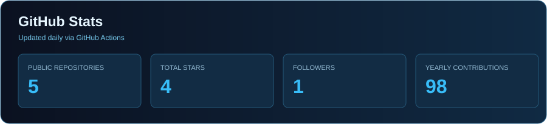
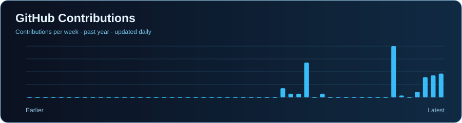

  

---

<h3 align="center">A Bit About Me</h3>

I'm a Brazilian creator who enjoys turning ideas into interactive experiences. 
I build <strong>game systems, Minecraft plugins, web tools</strong> and other creative projects. 
Beyond development, I'm into music, audiovisual production and online communities.

<h3 align="center">Tech Stack & Tools</h3>

<h3 align="center">Open-Source Projects</h3>

 

Some of my other projects are kept in private repositories.

<h3 align="center">GitHub Activity</h3>

<h3 align="center">Contribution Snake</h3>

Automatically updated through GitHub Actions.

---

<b>Build. Break. Improve. Repeat.</b>

Powered by curiosity, creativity and a few late-night commits.

